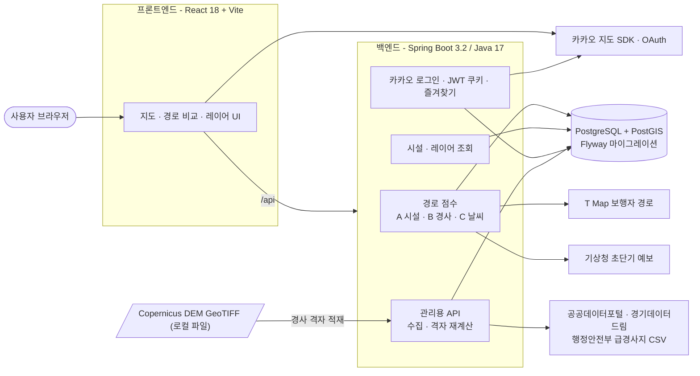

# FlatMap — 성남시 안전 보행 내비게이션

성남시에서 목적지까지 가는 **후보 경로를 야간 안전시설·경로 경사·날씨로 점수화해 비교**하고, 경로 주변의 붕괴위험 급경사지를 지도에서 확인할 수 있는 웹 서비스입니다.

> 서비스 이름은 **FlatMap** 입니다(2026-11-17 사용자 결정). 저장소 폴더 이름(`FlatMap_V2`)은 개발용 이름입니다.

이 프로젝트는 두 개의 기존 프로젝트를 합친 것입니다.

- **FlatMap** — 이 저장소의 기반(백엔드·프론트 뼈대). 로그인, 즐겨찾기, 날씨, 급경사지 경고, 우회 경로, 급경사지·생활 안전 정보 레이어.
- **SafetyRoad** — UI 디자인과 후보 경로·시설 기반 점수·시설 밀도 격자 아이디어를 가져왔습니다.

---

## 꼭 읽어 주세요 — 점수의 한계

- **경로 점수는 검증되지 않은 설계 파라미터로 계산한 상대 비교 값입니다.** 과학적으로 검증된 안전도·위험도가 아니며, 실제 안전이나 이동 가능 여부를 보증하지 않습니다. 화면의 "높은 편 / 보통 / 낮은 편"도 표시용 구간입니다.
- 점수의 가중치·반경·구간 경계·임계값은 모두 설정값(`backend/src/main/resources/application.properties`의 `score.*`, `walk.*`, `weather.correction.*`)이며, 값을 바꾸면 결과가 달라집니다.
- **보행난이도(경사)는 실제보다 낮게 나오는 경향이 있습니다.** 약 30m 격자 DEM(Copernicus GLO-30)에서 이웃 픽셀 평균으로 경사를 구하므로 평활화됩니다. 또 DEM은 건물·수목을 포함한 지표면 모델이라 짧은 급경사, 계단, 옹벽은 반영하지 못하고 건물·수목 가장자리 값은 어긋날 수 있습니다. 성남 범위 밖이거나 경사 데이터가 부족한 경로는 이 항목을 점수에 넣지 않습니다.
- **붕괴위험 급경사지**는 붕괴위험으로 지정된 곳만 모은 표본이며, 점수에 섞지 않고 지도 경고로만 보여 줍니다. 보행난이도 임계값을 적용하지 않습니다(두 축은 별개입니다). 경사도 단위는 각도(°)입니다.
- 시설이 적은 구역은 "위험"하다는 뜻이 아니라 **수집된 시설 데이터가 적다**는 뜻입니다.

## 구현된 기능

**경로 비교**
- 출발지·목적지를 정하면 T Map 보행자 경로를 4종 후보(일반 / 대로우선 / 최단 / 계단 제외)로 받아 경로마다 점수와 시설 개수를 보여 줍니다.
- 이동 기준 4가지(안전 우선 · 균형 · 빠른 길 · 오르막 최소)와 보행 유형 2가지(일반 · 보행약자)를 고를 수 있습니다. 보행 유형에 따라 경사 기준이 달라지며 보행약자 기준이 더 엄격합니다.
- 점수는 세 축의 가중 평균이고, 경로 카드의 "점수 내역"에서 축별 점수와 입력값을 볼 수 있습니다.

  | 축 | 내용 |
  |---|---|
  | A 야간 시설 노출 | 경로 주변 CCTV·보안등(50m)·경찰시설(300m)을 가중해 센 값을 경로 길이로 나눈 밀도 |
  | B 보행난이도 | 경로를 따라 읽은 DEM 경사를 보행 유형별 기준으로 양호/주의/위험 구간으로 나눈 비율 |
  | C 날씨 보정 | 기상청 초단기 예보(눈·비·영하·강풍)에 따른 보정. 기상 정보를 못 가져오면 이 항목을 빼고 계산 |

- 경로 주변에 붕괴위험 급경사지가 있으면 목록으로 알려 주고, 그 구간을 피하는 **우회 경로**를 요청할 수 있습니다(우회 채택 기준: 경고 구간이 줄어들 때). 우회 경로의 점수가 원경로보다 낮으면 그 폭을 보여 줍니다.

**지도 레이어**
- CCTV · 보안등 · 경찰시설(지도 영역 안만 조회), 시설 밀도 격자, 급경사지 경고
- 사고다발지 · 교통약자 보호구역 · 장애인복지시설 · 그늘막 · 노인복지관 (위치 안내용, 점수에 반영하지 않음)
- 오르막길 구간(급경사지 목록): 지역 필터, 경사 큰 순 정렬

**그 밖의 기능**
- 현재 위치 표시, 현재 위치 날씨, 경로별 날씨
- 카카오 로그인, 즐겨찾기(사용자별), 최근 검색 기록
- 긴급 신고 버튼(10초 카운트다운 후 112 전화 연결 링크)
- 시설 데이터 수집·재계산 관리용 API(`X-Admin-Api-Key` 헤더로 보호)

**개발 중 (아직 연동되지 않음)**
- RAG 기반 안내는 개발 중이며 현재는 어떤 기능에서도 쓰이지 않습니다.
  - 연동 지점만 준비해 두었습니다. 백엔드의 `RagClient` 인터페이스와 "미연결" 기본 구현체이며, **RAG 서버나 그 구현은 이 저장소에 없습니다.** 설정(`RAG_ENABLED`)의 기본값은 꺼짐이고, 꺼져 있으면 관련 엔드포인트(`/api/rag/*`)와 빈이 아예 등록되지 않습니다. 켜도 "미연결"이며, 화면은 켜짐이면서 연결됨일 때만 질문 진입점을 보여 주므로 기본 화면에는 나타나지 않습니다.

## 화면

> 스크린샷은 아직 넣지 않았습니다. 아래 파일 이름으로 `docs/images/`에 추가하면 됩니다.

| 자리 | 파일 이름 |
|---|---|
| 홈 화면 | `docs/images/home.png` |
| 경로 비교와 점수 내역 | `docs/images/route-compare.png` |
| 지도 레이어 | `docs/images/layers.png` |
| 우회 경로 | `docs/images/detour.png` |

## 아키텍처



- 공간 데이터(시설·급경사지·격자)는 PostGIS와 `JdbcTemplate`로 처리하고, 거리·반경 계산은 DB의 `ST_DWithin` 등으로 합니다. 경로 하나의 시설 집계와 경사 샘플링은 각각 SQL 한 번입니다.
- 사용자·즐겨찾기는 JPA를 씁니다.
- 경사는 DEM에서 **미리 계산해 DB 테이블(`walk_slope_cell`)에 저장**해 두고, 경로를 따라 읽기만 합니다.

## 로컬 실행

### 준비물
- JDK 17 이상, Node.js 22, PostgreSQL + **PostGIS**(또는 Docker)
- 카카오 JavaScript 키(지도), 외부 API 키(T Map, 기상청, 공공데이터 등 — 필요한 기능에 한해)
- 보행난이도 격자를 만들려면 Copernicus DEM GeoTIFF 한 장(위도 37~38°, 경도 127~128° 타일)

### 1. 환경변수
저장소 루트의 `.env.example`은 **키 이름만** 담고 있습니다. 복사해서 값을 채우세요. `.env`는 커밋하지 않습니다.

```bash
cp .env.example .env
cp frontend/.env.example frontend/.env   # VITE_KAKAO_API_KEY 등
```

| 구분 | 키 이름 |
|---|---|
| DB | `DB_NAME` `DB_USERNAME` `DB_PASSWORD` `DB_PORT` `DB_URL` |
| 테스트 DB | `TEST_DB_URL` `TEST_DB_USERNAME` `TEST_DB_PASSWORD` |
| 인증/보안 | `JWT_SECRET`(32바이트 이상) `ADMIN_API_KEY` `FRONTEND_URL` |
| 카카오 | `KAKAO_REST_API_KEY` `KAKAO_OAUTH_CLIENT_SECRET` `KAKAO_OAUTH_REDIRECT_URI` |
| 외부 API | `TMAP_APP_KEY` `WEATHER_API_KEY` `PUBLIC_DATA_API_KEY` `GYEONGGI_*` `DISASTER_*` |
| 선택 | `SEONGNAM_SECURITY_LIGHT_CSV_PATH`(보안등 CSV), `WALK_DEM_PATH`(DEM 경로) |

프론트(`frontend/.env`): `VITE_KAKAO_API_KEY`, `VITE_API_BASE_URL`, `VITE_BACKEND_URL`. 카카오 개발자 설정에서 사용할 주소(예: `http://localhost:3000`)를 **허용 도메인**에 등록해야 지도가 뜹니다.

### 2. 데이터베이스
**Docker Compose** (PostGIS 16 이미지, 기본 포트 5433):

```bash
docker compose up -d     # 개발 DB(<DB_NAME>)와 테스트 DB(<DB_NAME>_test)가 함께 만들어진다
```

**로컬 PostgreSQL**을 쓴다면 PostGIS를 설치하고, 개발 DB와 테스트 DB(이름이 `_test`로 끝나야 함)를 따로 만든 뒤 `.env`의 `DB_URL`·`TEST_DB_URL`을 맞추세요. 스키마는 앱이 뜰 때 Flyway가 만듭니다.

### 3. 백엔드 (포트 8080)
```bash
cd backend
./mvnw spring-boot:run       # Windows: mvnw.cmd spring-boot:run
```

### 4. 프론트엔드 (포트 3000)
```bash
cd frontend
npm install
npm run dev                  # /api 는 localhost:8080 으로 프록시. 다른 포트면 VITE_DEV_PROXY_TARGET
```

### 5. 데이터 채우기 (관리용 API)
처음에는 시설·격자 데이터가 비어 있어 지도에 아무것도 보이지 않습니다. 관리용 엔드포인트는 `X-Admin-Api-Key: <ADMIN_API_KEY>` 헤더가 필요합니다.

| 목적 | 호출 |
|---|---|
| 안전시설(CCTV·보안등·경찰시설) 수집 | `POST /api/safety/facilities/sync` (`?source=GG_CCTV` 처럼 소스를 하나만 지정 가능) |
| 시설 밀도 격자 계산 | `POST /api/density-grid/recalculate` (시설 수집 뒤에 실행) |
| 경사 격자 적재 | `POST /api/walk-difficulty/grid/rebuild` (DEM 파일 필요: `backend/dem/Copernicus_DSM_COG_10_N37_00_E127_00_DEM.tif` 또는 `WALK_DEM_PATH`) |
| 급경사지·생활 안전 정보 | `POST /api/steep-slope/fetch/all`, `POST /api/safety/fetch/*` |

DEM 파일과 `.env`는 저장소에 올라가지 않습니다(`.gitignore`).

## 배포

특정 클라우드에 종속되지 않는 Docker 이미지 2개(백엔드, 프론트)와 운영용 compose를 준비해 두었습니다. **실제 배포는 아직 하지 않았고, 배포할 클라우드도 정해지지 않았습니다.**

- 운영용 전체 스택: `docker-compose.prod.yml` (PostGIS + 백엔드 + nginx 프론트). 공개되는 것은 프론트 하나이고 DB는 호스트에 포트를 열지 않습니다. 개발용 `docker-compose.yml`은 DB만 띄우고, `--profile stack`을 주면 전체 스택을 개발 설정으로 띄웁니다.
- 절차(이미지 빌드, 시크릿 생성, 카카오 설정, 헬스체크, 첫 데이터 채우기, 운영): [`docs/DEPLOY.md`](docs/DEPLOY.md)
- 환경변수(키 이름·용도·필수 여부, 값 없음): [`docs/ENVIRONMENT.md`](docs/ENVIRONMENT.md)
- 운영 프로필(`prod`)은 개발용 기본값(localhost 주소, 짧은 JWT 비밀, 빈 관리 키)이 남아 있으면 기동하지 않습니다. 헬스체크는 `/actuator/health`(DB 연결 포함, 세부 정보 없음)입니다.

## 테스트와 CI

```bash
cd backend && ./mvnw test          # 실제 PostGIS 테스트 DB 필요(TEST_DB_*). 컨텍스트마다 Flyway clean → migrate
cd frontend && npm test            # Vitest
cd frontend && npm run build       # Vite 빌드
bash scripts/check-repo-hygiene.sh # 추적 파일에 비밀값·대용량 파일이 없는지 점검
```

- 테스트 DB는 **매번 비워지므로** 이름이 `_test`로 끝나지 않으면 테스트가 거부합니다(개발 DB 보호).
- 백엔드 통합 테스트는 외부 API(T Map, 기상청, 카카오)를 모킹하고 DB는 실제 PostGIS를 씁니다.
- GitHub Actions(`.github/workflows/ci.yml`): 백엔드(PostGIS 서비스 컨테이너 + JDK 17), 프론트(Node 22: Vitest + 빌드), Docker 이미지 빌드와 운영 compose 검증, 저장소 위생 점검을 모든 push와 PR에서 실행합니다.

## 저장소 구조

```
backend/    Spring Boot API (경로 점수 routescore/, 경사 walk/, 수집 ingestion/, 격자 density/, db/migration/)
frontend/   React + Vite (components/, hooks/, utils/ 순수 함수와 테스트)
docker/     테스트 DB 초기화 스크립트
docs/       CHANGELOG.md(단계별 변경 기록), DEPLOY.md(배포 가이드), ENVIRONMENT.md(환경변수), schema-merge.md(스키마 통합 근거)
backend/Dockerfile, frontend/Dockerfile, docker-compose*.yml   배포 산출물
scripts/    저장소 위생 점검
```

단계별 변경 내용과 한계는 [`docs/CHANGELOG.md`](docs/CHANGELOG.md)에 있습니다.

## 알려진 한계

- 안전시설 데이터 소스 6개 중 일부는 수집이 끝나지 않았습니다. 성남시 CCTV(`ODCLOUD_SEONGNAM_CCTV`)는 공공데이터포털에서 해당 데이터셋 활용 신청이 필요하고, 경기도 보안등(`GG_SECURITY_LIGHT`)은 약 30만 건 전체 수집 방식이 개선되지 않았습니다. 보안등이 덜 수집되면 A축 점수가 낮게 나옵니다.
- 지도 위 마커·오버레이는 자동 테스트 대상이 아닙니다(순수 로직과 화면 문구만 테스트). 카카오 SDK가 필요해 수동 확인이 필요합니다.
- T Map·기상청 실서버 호출은 자동 테스트에서 검증하지 않습니다(모킹).
- Docker 이미지 빌드와 `docker compose`(개발용·운영용 모두)는 이 프로젝트 개발 환경에 Docker가 없어 직접 실행해 보지 못했습니다. 파일 구조는 자동 테스트가 검사하고, 패키징한 JAR를 환경변수만으로 기동하는 것까지는 확인했습니다. 이미지 빌드는 CI가 처음 실행합니다.
- 후보 경로 4종은 T Map을 순차 호출하므로 최악의 응답 지연은 호출 수 × 읽기 타임아웃(5초)입니다.

## 데이터 출처

공공데이터포털, 경기데이터드림, 행정안전부 급경사지 현황, 기상청 초단기 예보, T Map, 카카오 지도, Copernicus DEM(GLO-30). 각 데이터의 이용 조건은 제공처의 안내를 따르세요.
